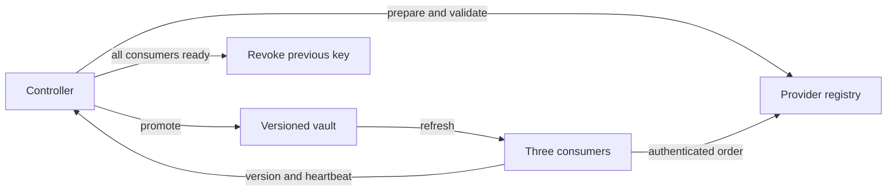

# Safe credential rotation for automation

A runnable local lab showing how an order workflow keeps operating while its credential changes. Replacing a secret in storage alone does not prove that every consumer still works.

## Run

Python 3.9+ on macOS or Linux; standard library only. From the repository root:

    python3 projects/06-safe-credential-rotation/tools/rotation.py
    python3 projects/06-safe-credential-rotation/tools/rotation.py --scenario failed-validation
    python3 projects/06-safe-credential-rotation/tools/rotation.py --scenario stale-worker
    python3 -m unittest discover -s tests -v

The demo creates an owner-only temporary SQLite database, closes it and removes it on exit. No external accounts, network calls, cloud costs or real credentials are involved.

## Architecture and trust boundaries

Workers acknowledge the version with a recent heartbeat. Only after every configured worker acknowledges does the controller revoke the previous key. Audit output contains lifecycle events and version identifiers, never tokens.

Provider, vault and workers are separate logical roles in one database. This gives atomic local changes and deliberately simplifies distributed failures. The controller and worker registry are trusted. Anyone who can access the database can control the lab. There is no actor authorization or network authentication layer.

## Lifecycle

1. Prepare a random candidate while the previous credential remains valid.
2. Validate before promotion. Failed validation revokes only the candidate.
3. Promote with a bounded overlap window.
4. Require every registered worker to acknowledge the new version with a recent heartbeat.
5. Revoke the old key only after acknowledgement. A missed deadline rolls back and refreshes the local workers before revoking the candidate.

Worker enrollment freezes during rotation. Versions are never reused after failure. SQLite preserves rotation state across controller restarts. Unique order IDs prevent duplicate side effects during retries.

## Results

[Recorded results](examples/results.json) contain three scenarios, each attempting 300 synthetic operations across three workers. All three completed 300 operations with zero authentication failures. Success retired the previous key; failed validation preserved the original key; a stale consumer caused rollback.

These are sequential operations on a logical clock, not production throughput measurements or proof of cloud service availability. Sixteen tests cover overlap, old-key rejection, stale acknowledgements, premature promotion, restart recovery, competing preparation, rollback, idempotency and secret-free output. The full repository suite has 57 tests.

## Identity and rotation

Use [the existing federated CI identity reference](../01-multicloud-landing-zone/README.md) to avoid long-lived deployment keys. This lab covers remaining dependencies that need passwords or API keys. It does not implement OIDC. References: [GitHub OIDC](https://docs.github.com/en/actions/concepts/security/openid-connect) and [AWS rotation strategies](https://docs.aws.amazon.com/secretsmanager/latest/userguide/rotation-strategy.html).

## Threat model

| Failure | Demonstrated control | Production requirement |
| --- | --- | --- |
| Candidate cannot authenticate | Validation prevents promotion | Real health and scope check |
| Worker caches old key | Overlap and version acknowledgement | Discover all consumers and refresh connection pools |
| Controller restarts | Durable local state | Reconcile partial remote calls |
| Competing rotations | Serialized preparation and retirement | Distributed lease and fencing |
| Retry repeats order | Unique order ID | Remote idempotency or transactional outbox |
| Secrets in output | Reports omit tokens | Encrypted vault, access controls, redaction |
| Cutover misses deadline | Local rollback | Provider-specific rollback and consumer convergence |

Random lab tokens are stored in plaintext in an owner-only disposable database. Logical revocation does not guarantee forensic erasure from SQLite pages. Never insert real credentials.

The provider must support overlapping credentials. Single-key providers need another strategy; OAuth refresh tokens may require reauthorization rather than arbitrary replacement. Real remote APIs are not atomic together. Cloud adapters and scheduled production rotation remain future work. Emergency revocation of a compromised key may deliberately sacrifice availability rather than retain exposed access.

## Next milestone

Choose one generic commerce integration, such as inventory sync or order import. Document its issue, expiry and revoke semantics, add an adapter and measure continuous requests in a disposable sandbox. No private procedures or data are needed.

## Cleanup and license

The CLI and tests remove disposable state on exit. If using the class manually, close the connection and delete its lab database afterward. No infrastructure is provisioned. Apache 2.0, inherited from the repository.
